# SUCCESS & ACADEMIC ANALYTICS PLATFORM (SAAP)
## Entity-Relationship Diagram (ERD) Specification
**Document Reference:** `SAAP-DES-ERD-001`  
**Project Phase:** Semester 3 — Requirements, Design & Basic Prototype (Step 4: ER Diagram and Database Design)  
**Source of Truth:** SAAP Software Requirements Specification (SRS) Version 1.0 (Section 18 & Appendix A)  
**Status:** Design Baseline  

---

## 1. Overview and Design Principles

This document presents the logical Entity-Relationship Diagram (ERD) for the Success & Academic Analytics Platform (SAAP), derived directly from **SRS Section 18 (*Database Requirements*)** and **SRS Appendix A (*Database Entity Relationships*)**.

### Architectural Baseline
1. **Core Relational Engine:** PostgreSQL relational design utilizing UUID surrogate primary keys for transactional entities and standard integer keys for fixed metadata (e.g., `Roles`, `Permissions`).
2. **Explicit Scope Containment:** Data relationships enforce institutional boundaries (Department $\rightarrow$ Program $\rightarrow$ Batch $\rightarrow$ Student $\rightarrow$ Academic Transactions).
3. **Auditability & Immutability:** Academic history (`StudentMarks`, `AttendanceRecords`, `SemesterResults`) is decoupled from ad-hoc modifications and guarded by foreign key links to `AuditLogs` and `ImportJobs`.
4. **Adherence to SRS Entities:** Exactly 27 entities specified in SRS Section 18 are modeled. Essential junction tables or missing link entities necessary for relational integrity are explicitly marked as `Proposed — not explicitly specified in SRS`.

---

## 2. Complete Visual Mermaid ER Diagram

```mermaid
erDiagram
    USERS ||--o{ USER_ROLES : "assigned in"
    ROLES ||--o{ USER_ROLES : "granted to"

    USERS |o--o| STUDENTS : "authenticates as"
    USERS ||--o{ MENTOR_ASSIGNMENTS : "acts as mentor"
    USERS ||--o{ IMPORT_JOBS : "uploads"
    USERS ||--o{ REPORT_JOBS : "requests"
    USERS ||--o{ AUDIT_LOGS : "triggers action"

    DEPARTMENTS ||--o{ PROGRAMS : "offers"
    PROGRAMS ||--o{ BATCHES : "contains"
    PROGRAMS ||--o{ SEMESTERS : "schedules"
    ACADEMIC_YEARS ||--o{ SEMESTERS : "spans"

    STUDENTS ||--o{ STUDENT_ENROLLMENTS : "enrolled under"
    PROGRAMS ||--o{ STUDENT_ENROLLMENTS : "enrolls"
    BATCHES ||--o{ STUDENT_ENROLLMENTS : "groups"

    STUDENTS ||--o{ MENTOR_ASSIGNMENTS : "guided under"

    SUBJECTS ||--o{ ASSESSMENTS : "evaluated by"
    SEMESTERS ||--o{ ASSESSMENTS : "conducted during"

    STUDENTS ||--o{ STUDENT_MARKS : "scores"
    ASSESSMENTS ||--o{ STUDENT_MARKS : "records score for"

    STUDENTS ||--o{ ATTENDANCE_RECORDS : "maintains"
    SUBJECTS ||--o{ ATTENDANCE_RECORDS : "logs for"
    SEMESTERS ||--o{ ATTENDANCE_RECORDS : "recorded in"

    STUDENTS ||--o{ SEMESTER_RESULTS : "achieves"
    SEMESTERS ||--o{ SEMESTER_RESULTS : "issued in"

    STUDENTS ||--o{ BACKLOG_RECORDS : "incurs"
    SUBJECTS ||--o{ BACKLOG_RECORDS : "pending in"
    SEMESTERS ||--o{ BACKLOG_RECORDS : "originated in"

    IMPORT_JOBS ||--o{ IMPORT_ERRORS : "identifies"

    INSIGHTS ||--o{ RECOMMENDATIONS : "generates"

    ML_MODELS ||--o{ PREDICTIONS : "generates"
    STUDENTS |o--o{ PREDICTIONS : "scored for"

    USERS {
        UUID user_id PK
        VARCHAR username UK
        VARCHAR email UK
        VARCHAR password_hash
        BOOLEAN is_active
        TIMESTAMP created_at
    }

    ROLES {
        INT role_id PK
        VARCHAR role_name UK
        VARCHAR description
    }

    PERMISSIONS {
        INT permission_id PK
        VARCHAR permission_code UK
    }

    USER_ROLES {
        UUID user_id FK
        INT role_id FK
        TIMESTAMP assigned_at
    }

    DEPARTMENTS {
        UUID department_id PK
        VARCHAR department_name
        VARCHAR code UK
    }

    PROGRAMS {
        UUID program_id PK
        UUID department_id FK
        VARCHAR program_name
        VARCHAR code
    }

    BATCHES {
        UUID batch_id PK
        UUID program_id FK
        VARCHAR batch_name
        INT admission_year
    }

    ACADEMIC_YEARS {
        UUID academic_year_id PK
        VARCHAR year_label
        DATE start_date
        DATE end_date
    }

    SEMESTERS {
        UUID semester_id PK
        UUID program_id FK
        INT semester_number
        UUID academic_year_id FK
    }

    SUBJECTS {
        UUID subject_id PK
        VARCHAR subject_code UK
        VARCHAR subject_name
        DECIMAL credits
    }

    STUDENTS {
        UUID student_id PK
        VARCHAR institutional_identifier UK
        UUID user_id FK
        VARCHAR full_name
        VARCHAR status
    }

    STUDENT_ENROLLMENTS {
        UUID enrollment_id PK
        UUID student_id FK
        UUID program_id FK
        UUID batch_id FK
        VARCHAR status
    }

    MENTOR_ASSIGNMENTS {
        UUID assignment_id PK
        UUID mentor_user_id FK
        UUID student_id FK
        DATE start_date
        DATE end_date
    }

    ASSESSMENTS {
        UUID assessment_id PK
        UUID subject_id FK
        UUID semester_id FK
        VARCHAR assessment_type
        DECIMAL max_marks
    }

    STUDENT_MARKS {
        UUID student_mark_id PK
        UUID student_id FK
        UUID assessment_id FK
        DECIMAL marks_obtained
        TIMESTAMP recorded_at
    }

    ATTENDANCE_RECORDS {
        UUID attendance_id PK
        UUID student_id FK
        UUID subject_id FK
        UUID semester_id FK
        INT classes_held
        INT classes_attended
        DECIMAL attendance_percentage
    }

    SEMESTER_RESULTS {
        UUID result_id PK
        UUID student_id FK
        UUID semester_id FK
        DECIMAL sgpa
        DECIMAL cgpa
        VARCHAR result_status
        TIMESTAMP published_at
    }

    BACKLOG_RECORDS {
        UUID backlog_id PK
        UUID student_id FK
        UUID subject_id FK
        UUID semester_id FK
        VARCHAR status
        DATE cleared_at
    }

    IMPORT_JOBS {
        UUID import_job_id PK
        VARCHAR data_type
        UUID uploaded_by FK
        VARCHAR status
        INT total_rows
        INT valid_rows
        INT invalid_rows
        TIMESTAMP created_at
    }

    IMPORT_ERRORS {
        UUID import_error_id PK
        UUID import_job_id FK
        INT row_number
        VARCHAR field_name
        TEXT error_message
    }

    ANALYTICS_SNAPSHOTS {
        UUID snapshot_id PK
        VARCHAR scope_type
        VARCHAR scope_id
        VARCHAR metric_name
        JSONB metric_value
        TIMESTAMP calculated_at
    }

    INSIGHTS {
        UUID insight_id PK
        VARCHAR scope_type
        VARCHAR scope_id
        VARCHAR title
        JSONB evidence
        TIMESTAMP created_at
    }

    RECOMMENDATIONS {
        UUID recommendation_id PK
        UUID insight_id FK
        TEXT recommendation_text
        VARCHAR status
    }

    ML_MODELS {
        UUID model_id PK
        VARCHAR model_name
        VARCHAR version
        VARCHAR status
        JSONB metrics
    }

    PREDICTIONS {
        UUID prediction_id PK
        UUID student_id FK
        UUID model_id FK
        VARCHAR prediction_type
        DECIMAL score
        JSONB explanation
        TIMESTAMP created_at
    }

    REPORT_JOBS {
        UUID report_job_id PK
        UUID requested_by FK
        VARCHAR report_type
        VARCHAR status
        TIMESTAMP created_at
    }

    AUDIT_LOGS {
        UUID audit_id PK
        UUID actor_user_id FK
        VARCHAR action
        VARCHAR entity_type
        VARCHAR entity_id
        VARCHAR result
        TIMESTAMP created_at
    }
```

---

## 3. Detailed Relationship Catalog and Cardinality Analysis

### 3.1 Security and RBAC Subsystem
* **Users $\longleftrightarrow$ UserRoles $\longleftrightarrow$ Roles (Many-to-Many via Junction Table):**
  - `USERS (1)` $\longleftrightarrow$ `(0..N) USER_ROLES`
  - `ROLES (1)` $\longleftrightarrow$ `(0..N) USER_ROLES`
  - **Cardinality:** A user may possess one or more roles (e.g., a Faculty member who also acts as a Mentor). A role is assigned to zero, one, or many users.
  - **Integrity Rule:** Composite uniqueness on `(user_id, role_id)`. Cascading deletion on `user_id` when an account is expunged.
* **Permissions Entity:**
  - Defined in SRS Section 18 (`permission_id INT PK`, `permission_code VARCHAR(100) UNIQUE`).
  - *Integrity Note:* The junction table between `Roles` and `Permissions` (`RolePermissions`) is **not explicitly specified in Section 18**, although `Permissions` is listed. See Section 5 for the proposed bridge.

### 3.2 Academic Structure Subsystem
* **Departments $\longleftrightarrow$ Programs (One-to-Many):**
  - `DEPARTMENTS (1)` $\longleftrightarrow$ `(1..N) PROGRAMS`
  - A Department (e.g., Computer Science and Engineering) houses multiple academic degree programs (e.g., B.Tech CSE, M.Tech CSE). Each program belongs to exactly one department.
* **Programs $\longleftrightarrow$ Batches (One-to-Many):**
  - `PROGRAMS (1)` $\longleftrightarrow$ `(1..N) BATCHES`
  - A Program enrolls students in yearly cohorts/batches (e.g., "Batch 2024-2028"). Each batch is strictly anchored to its parent program.
* **Programs $\longleftrightarrow$ Semesters (One-to-Many):**
  - `PROGRAMS (1)` $\longleftrightarrow$ `(1..N) SEMESTERS`
  - Each academic semester term (e.g., Semester 3, Semester 4) is structured under a specific program curriculum.
* **AcademicYears $\longleftrightarrow$ Semesters (One-to-Many):**
  - `ACADEMIC_YEARS (1)` $\longleftrightarrow$ `(1..N) SEMESTERS`
  - An academic year (e.g., "2026-2027", July 1 to June 30) spans multiple program semesters.
* **Programs $\longleftrightarrow$ Subjects (Appendix A Curriculum Scope):**
  - In SRS Section 18, `Subjects` contains catalog attributes (`subject_code`, `subject_name`, `credits`), without a direct `program_id` FK.
  - Appendix A states: `Programs ──< Subjects (through curriculum mapping if implemented)`.
  - In the baseline SRS schema, the operational association between Subjects and Semesters occurs transitively through `Assessments` (`subject_id FK`, `semester_id FK`), `AttendanceRecords`, and `BacklogRecords`.

### 3.3 Student and Mentorship Subsystem
* **Users $\longleftrightarrow$ Students (One-to-Zero-or-One):**
  - `USERS (1)` $\longleftrightarrow$ `(0..1) STUDENTS`
  - `STUDENTS.user_id` is a nullable foreign key. This accommodates pre-enrolled or imported students prior to login account activation. Once activated, each student maps to at most one user credential.
* **Students $\longleftrightarrow$ StudentEnrollments (One-to-Many):**
  - `STUDENTS (1)` $\longleftrightarrow$ `(1..N) STUDENT_ENROLLMENTS`
  - A student must have at least one active enrollment record binding them to a `Program` and `Batch`. Lateral entry or branch changes produce sequential enrollment records with status flags.
* **Users (Mentor) $\longleftrightarrow$ MentorAssignments $\longleftrightarrow$ Students (Many-to-Many with Temporal Validity):**
  - `USERS (1)` $\longleftrightarrow$ `(0..N) MENTOR_ASSIGNMENTS`
  - `STUDENTS (1)` $\longleftrightarrow$ `(0..N) MENTOR_ASSIGNMENTS`
  - Represents mentorship assignments. Controlled by `start_date` and nullable `end_date`. An active assignment has `end_date IS NULL`.

### 3.4 Academic Performance & Assessment Subsystem
* **Subjects $\longleftrightarrow$ Assessments $\longleftrightarrow$ Semesters (Many-to-One):**
  - `SUBJECTS (1)` $\longleftrightarrow$ `(0..N) ASSESSMENTS`
  - `SEMESTERS (1)` $\longleftrightarrow$ `(0..N) ASSESSMENTS`
  - An assessment component (e.g., "Class Test 1", "Mid-Term", "End-Sem Practical") is defined for a subject in a specific semester.
* **Students $\longleftrightarrow$ StudentMarks $\longleftrightarrow$ Assessments (Many-to-Many via Transaction):**
  - `STUDENTS (1)` $\longleftrightarrow$ `(0..N) STUDENT_MARKS`
  - `ASSESSMENTS (1)` $\longleftrightarrow$ `(0..N) STUDENT_MARKS`
  - Stores the marks obtained by a student in an assessment. Must satisfy `marks_obtained <= Assessments.max_marks`.
* **Students $\longleftrightarrow$ AttendanceRecords $\longleftrightarrow$ (Subjects, Semesters):**
  - `STUDENTS (1)` $\longleftrightarrow$ `(0..N) ATTENDANCE_RECORDS`
  - `SUBJECTS (1)` $\longleftrightarrow$ `(0..N) ATTENDANCE_RECORDS`
  - `SEMESTERS (1)` $\longleftrightarrow$ `(0..N) ATTENDANCE_RECORDS`
  - Captures cumulative attendance metrics (`classes_held`, `classes_attended`, `attendance_percentage`) per student per subject per semester.
* **Students $\longleftrightarrow$ SemesterResults $\longleftrightarrow$ Semesters:**
  - `STUDENTS (1)` $\longleftrightarrow$ `(0..N) SEMESTER_RESULTS`
  - `SEMESTERS (1)` $\longleftrightarrow$ `(0..N) SEMESTER_RESULTS`
  - Captures official terminal result metrics: `sgpa`, `cgpa`, and `result_status` (e.g., PASS, ATKT, FAIL).
* **Students $\longleftrightarrow$ BacklogRecords $\longleftrightarrow$ (Subjects, Semesters):**
  - `STUDENTS (1)` $\longleftrightarrow$ `(0..N) BACKLOG_RECORDS`
  - `SUBJECTS (1)` $\longleftrightarrow$ `(0..N) BACKLOG_RECORDS`
  - `SEMESTERS (1)` $\longleftrightarrow$ `(0..N) BACKLOG_RECORDS`
  - Maintains individual backlog history. When cleared in a supplementary exam, `status` updates and `cleared_at` is recorded.

### 3.5 Ingestion, Reporting, and System Governance Subsystem
* **ImportJobs $\longleftrightarrow$ ImportErrors (One-to-Many):**
  - `IMPORT_JOBS (1)` $\longleftrightarrow$ `(0..N) IMPORT_ERRORS`
  - Every batch staging job logs row-level diagnostic failures in `ImportErrors`.
* **Users $\longleftrightarrow$ ImportJobs (One-to-Many):**
  - `USERS (1)` $\longleftrightarrow$ `(0..N) IMPORT_JOBS` (`uploaded_by FK`).
* **Users $\longleftrightarrow$ ReportJobs (One-to-Many):**
  - `USERS (1)` $\longleftrightarrow$ `(0..N) REPORT_JOBS` (`requested_by FK`).
* **Users $\longleftrightarrow$ AuditLogs (One-to-Many):**
  - `USERS (1)` $\longleftrightarrow$ `(0..N) AUDIT_LOGS` (`actor_user_id FK`).

### 3.6 Analytics and AI/ML Subsystem
* **Insights $\longleftrightarrow$ Recommendations (One-to-Many):**
  - `INSIGHTS (1)` $\longleftrightarrow$ `(0..N) RECOMMENDATIONS`
  - An evidence-backed insight (e.g., "Sharp drop in Subject Y attendance") generates one or more prescriptive recommendations.
* **MLModels $\longleftrightarrow$ Predictions (One-to-Many):**
  - `ML_MODELS (1)` $\longleftrightarrow$ `(0..N) PREDICTIONS`
  - Predictions are strictly stamped with the generating `model_id` (`BR-008`).
* **Students $\longleftrightarrow$ Predictions (One-to-Many, Nullable FK):**
  - `STUDENTS (1)` $\longleftrightarrow$ `(0..N) PREDICTIONS`
  - `student_id` is nullable to allow both student-level risk scores and cohort/batch-level aggregate predictions.
* **AnalyticsSnapshots (Polymorphic / Standalone Aggregate Store):**
  - `AnalyticsSnapshots` utilizes `scope_type` (e.g., 'STUDENT', 'BATCH', 'DEPARTMENT') and `scope_id` without rigid foreign keys to support multi-level caching.

---

## 4. Relationship Summary Table

| Source Entity | Target Entity | Foreign Key Field | Cardinality | Business Meaning / Integrity Constraint |
|---|---|---|---|---|
| `UserRoles` | `Users` | `user_id` | $N : 1$ | Account identity for role binding |
| `UserRoles` | `Roles` | `role_id` | $N : 1$ | Role assigned to user |
| `Students` | `Users` | `user_id` | $0..1 : 1$ | Optional login account mapping |
| `Programs` | `Departments` | `department_id` | $N : 1$ | Academic department offering the program |
| `Batches` | `Programs` | `program_id` | $N : 1$ | Degree program defining the batch |
| `Semesters` | `Programs` | `program_id` | $N : 1$ | Curriculum term belonging to program |
| `Semesters` | `AcademicYears` | `academic_year_id` | $N : 1$ | Calendar academic year for semester |
| `StudentEnrollments` | `Students` | `student_id` | $N : 1$ | Student being enrolled |
| `StudentEnrollments` | `Programs` | `program_id` | $N : 1$ | Degree program enrollment |
| `StudentEnrollments` | `Batches` | `batch_id` | $N : 1$ | Student admission batch |
| `MentorAssignments` | `Users` | `mentor_user_id` | $N : 1$ | Faculty user serving as mentor |
| `MentorAssignments` | `Students` | `student_id` | $N : 1$ | Mentee assigned |
| `Assessments` | `Subjects` | `subject_id` | $N : 1$ | Subject evaluated |
| `Assessments` | `Semesters` | `semester_id` | $N : 1$ | Term during which assessment occurs |
| `StudentMarks` | `Students` | `student_id` | $N : 1$ | Student obtaining the mark |
| `StudentMarks` | `Assessments` | `assessment_id` | $N : 1$ | Specific assessment scored |
| `AttendanceRecords` | `Students` | `student_id` | $N : 1$ | Student attendance subject |
| `AttendanceRecords` | `Subjects` | `subject_id` | $N : 1$ | Subject attendance tracked |
| `AttendanceRecords` | `Semesters` | `semester_id` | $N : 1$ | Semester attendance tracked |
| `SemesterResults` | `Students` | `student_id` | $N : 1$ | Student receiving result |
| `SemesterResults` | `Semesters` | `semester_id` | $N : 1$ | Semester result issued |
| `BacklogRecords` | `Students` | `student_id` | $N : 1$ | Student incurring backlog |
| `BacklogRecords` | `Subjects` | `subject_id` | $N : 1$ | Subject with active/cleared backlog |
| `BacklogRecords` | `Semesters` | `semester_id` | $N : 1$ | Semester where backlog originated |
| `ImportJobs` | `Users` | `uploaded_by` | $N : 1$ | User executing staging upload |
| `ImportErrors` | `ImportJobs` | `import_job_id` | $N : 1$ | Parent import job with diagnostics |
| `Recommendations` | `Insights` | `insight_id` | $N : 1$ | Insight generating recommendation |
| `Predictions` | `MLModels` | `model_id` | $N : 1$ | Model producing the risk score |
| `Predictions` | `Students` | `student_id` | $N : 0..1$ | Student evaluated (NULL for cohort models) |
| `ReportJobs` | `Users` | `requested_by` | $N : 1$ | User requesting report export |
| `AuditLogs` | `Users` | `actor_user_id` | $N : 1$ | User triggering audited transaction |

---

## 5. Potential Relationship Omissions in SRS (Design Observations)

In compliance with project instructions, the baseline diagram above includes **only** the 27 entities defined in SRS Section 18. However, the following relational gaps exist in the current specification:

1. **Role-Permission Junction (`RolePermissions`):**
   - *Status:* **Proposed — not explicitly specified in SRS**.
   - *Reason:* SRS Section 18 defines `Roles` and `Permissions` but provides no junction table. Without `RolePermissions(role_id FK, permission_id FK)`, permissions cannot be dynamically linked to roles in SQL.
2. **Faculty Subject Allocation (`FacultySubjectAllocations`):**
   - *Status:* **Proposed — not explicitly specified in SRS**.
   - *Reason:* SRS Business Rule `BR-003` restricts faculty access to their "authorized academic scope." However, Section 18 has no table mapping a faculty `user_id` to `subject_id` and `batch_id`.
3. **Curriculum Mapping (`ProgramSubjects`):**
   - *Status:* **Proposed — not explicitly specified in SRS** (Acknowledged in SRS Appendix A: *"through curriculum mapping if implemented"*).
   - *Reason:* Directly links `program_id`, `semester_number`, and `subject_id` to define canonical degree curriculums.

*Note: These proposals are formally cataloged in `docs/database/database-review.md` and are NOT implemented in the schema without user authorization.*
