# SUCCESS & ACADEMIC ANALYTICS PLATFORM (SAAP)
## UI Wireframes and Screen Specifications
**Document Reference:** `SAAP-DES-UIW-001`  
**Project Phase:** Semester 3 — Requirements, Design & Basic Prototype (Step 5: Prepare UI Wireframes)  
**Source of Truth:** SAAP Software Requirements Specification (SRS) Version 1.0 (Section 10, 15, 16, 17, 24, 25)  
**Design Target:** Desktop Responsive Web (React Architecture Baseline)  
**Status:** Approved Design Baseline  

---

## 1. Overview and Design Objectives

This document establishes the initial UI wireframe specifications for the 16 screens defined in **SRS Section 17 (*User Interface Specifications*)**.

### Core UX Principles
1. **Role-Driven Layouts:** Information presentation strictly adapts to authenticated role context (Student, Mentor, Faculty, Department User, Academic Administrator, Data Analyst, ML Engineer, System Administrator, Auditor).
2. **Decision-Support Visibility:** Predictive outputs and recommendations are explicitly labeled as decision-support indicators rather than guaranteed deterministic outcomes (`BR-009`, Section 12).
3. **Controlled Action Gating:** Bulk operations (such as data import) enforce a two-step validation and approval flow before database commitment (`BR-005`, `BR-006`).
4. **Information Hierarchy:** Key Performance Indicators (KPIs) and summary metric cards anchor the top view, followed by analytical trend charts, tabular drill-downs, and evidence-backed recommendations.

---

## 2. Global Navigation and Screen Flow Architecture

### 2.1 Navigation Flowchart

```mermaid
flowchart TD
    SCR001["SCR-001: Login Screen"] --> AUTH{Authenticate & Resolve Role}

    AUTH -->|Student| S_DASH["SCR-002: Student Dashboard"]
    S_DASH --> S_PROF["SCR-003: Academic Profile"]
    S_DASH --> S_MRK["SCR-004: Marks & Assessments"]
    S_DASH --> S_ATT["SCR-005: Attendance View"]
    S_DASH --> S_INS["SCR-013: Insights & Recommendations"]
    S_DASH --> S_REP["SCR-015: Reports (Own Scope)"]

    AUTH -->|Mentor| M_DASH["SCR-006: Mentor Dashboard"]
    M_DASH --> M_DET["SCR-003: Student Detail (Assigned)"]
    M_DASH --> M_INS["SCR-013: Insights (Assigned)"]
    M_DASH --> M_PRED["SCR-014: Prediction Analytics"]
    M_DASH --> M_REP["SCR-015: Reports (Mentee Scope)"]

    AUTH -->|Faculty| F_ANL["SCR-007: Faculty Analytics"]
    F_ANL --> F_MRK["SCR-004: Marks Entry & View"]
    F_ANL --> F_ATT["SCR-005: Attendance Entry & View"]
    F_ANL --> F_IMP["SCR-009: Data Import (Marks/Att)"]
    F_ANL --> F_PRED["SCR-014: Prediction Analytics"]

    AUTH -->|Department User| D_ANL["SCR-008: Department Analytics"]
    D_ANL --> D_INS["SCR-013: Department Insights"]
    D_ANL --> D_PRED["SCR-014: Prediction Analytics (Aggregate)"]
    D_ANL --> D_REP["SCR-015: Reports (Department Scope)"]

    AUTH -->|Academic Admin| A_MD["SCR-011: Academic Master Data"]
    A_MD --> A_IMP["SCR-009: Data Import Center"]
    A_IMP --> A_VAL["SCR-010: Import Validation Result"]
    A_MD --> A_PROF["SCR-003: Student Profiles (All)"]
    A_MD --> A_REP["SCR-015: Reports (Institutional)"]

    AUTH -->|System Admin| U_MGT["SCR-012: User Management"]
    U_MGT --> S_HLT["SCR-016: Audit & System Health"]
    U_MGT --> S_CFG["System Configuration"]

    AUTH -->|Auditor / Viewer| AUD_V["SCR-016: Audit & System Health (Read-Only)"]
    AUD_V --> AUD_R["SCR-015: Compliance Reports"]

    AUTH -->|Data Analyst| DA_ANL["SCR-008 / SCR-013 / SCR-014: Analytics & Insights Config"]
    AUTH -->|ML Engineer| ML_MGT["SCR-014: Prediction & Model Evaluation"]
```



### 2.2 Global App Shell Layout
All authenticated screens share a standard enterprise application shell:
- **Top Navigation Bar:** Institutional Logo, Current Active Academic Year/Semester indicator, Global Search (where authorized), Role Badge, Notification Bell (alerts), and Profile / Logout menu.
- **Left Sidebar:** Role-tailored menu items with active state indication, collapsible on smaller screens.
- **Main Content Area:** Standard breadcrumb trail, page header with contextual filter bar, and responsive widget grid.
- **Status / Footer Bar:** System build/version, active database connectivity status, and decision-support disclaimer banner.

---

## 3. Screen Specifications (SCR-001 through SCR-016)

---

### SCR-001 — Login

```
+--------------------------------------------------------------------------------+
|                   SUCCESS & ACADEMIC ANALYTICS PLATFORM                        |
|                                                                                |
|                        +----------------------------+                          |
|                        |       ACCOUNT SIGN IN      |                          |
|                        |                            |                          |
|                        | Username or Email          |                          |
|                        | [________________________] |                          |
|                        |                            |                          |
|                        | Password                   |                          |
|                        | [************************] |                          |
|                        |                            |                          |
|                        | [  LOG IN  ]     [ CLEAR ] |                          |
|                        |                            |                          |
|                        | (i) Unauthorized access is |                          |
|                        |     monitored and audited. |                          |
|                        +----------------------------+                          |
|                                                                                |
+--------------------------------------------------------------------------------+
```

1. **Screen ID:** `SCR-001`
2. **Screen Name:** Login
3. **Primary User / Role:** All Users (`Student`, `Mentor`, `Faculty`, `Department User`, `Academic Administrator`, `Data Analyst`, `ML Engineer`, `System Administrator`, `Auditor/Viewer`).
4. **Purpose:** Authenticates active users via secure credentials and issues a role-scoped session token (`FR-001`, `MOD-001`).
5. **Navigation:** Entry route (`/login`). Upon successful verification, routes automatically to the role's primary landing screen.
6. **Main Sections:**
   - Institutional Header
   - Centered Authentication Card
   - Legal & Security Monitoring Notice
7. **Components / Widgets:**
   - Username/Email text input (*SRS-defined*)
   - Password masked input (*SRS-defined*)
   - Login submission button (*SRS-defined*)
   - Clear input button (*SRS-defined*)
   - Inline alert notification box for validation errors (*SRS-defined*)
8. **Data Displayed:** None prior to login. Error feedback on invalid attempts.
9. **User Actions:**
   - Enter username or email.
   - Enter password.
   - Click "LOG IN" to submit credentials.
   - Click "CLEAR" to reset fields.
10. **Access Restrictions:** Publicly accessible endpoint; requires valid, active credentials in `Users` table.
11. **Important Validation / Error States:**
    - Empty username or password $\rightarrow$ Inline error: *"Username/Email and Password are required."*
    - Invalid credentials $\rightarrow$ Banner error: `ERR-AUTH-001` *"Invalid username or password."*
    - Inactive / Suspended account $\rightarrow$ Banner error: `ERR-AUTH-002` *"Account is inactive. Contact Administrator."*
    - Account locked / Rate-limited $\rightarrow$ `ERR-AUTH-003` *"Too many failed attempts. Account temporarily locked."*

---

### SCR-002 — Student Dashboard

```
+----------------------------------------------------------------------------------------------------+
| LOGO | SAAP   Academic Year: 2026-27 | Sem 3          [ Student: Aryansh S. ] [ Notifications ] [Logout] |
+----------------------------------------------------------------------------------------------------+
| [NAV: Dashboard* | Profile | Marks | Attendance | Results | Insights | Reports ]                       |
+----------------------------------------------------------------------------------------------------+
| OVERVIEW KPI METRICS                                                                               |
| +--------------------+ +--------------------+ +--------------------+ +-----------------------------+ |
| | Current SGPA       | | Current CGPA       | | Attendance Rate    | | Active Backlogs             | |
| |      8.42          | |      8.15          | |      84.5%         | |          0                  | |
| | Trend: +0.25 (Good)| | Cohort Rank: Top15%| | Min Req: 75.0%     | | Status: Clear               | |
| +--------------------+ +--------------------+ +--------------------+ +-----------------------------+ |
|                                                                                                    |
| PERFORMANCE TRENDS & SUBJECT BREAKDOWN                                                             |
| +--------------------------------------------------+ +-------------------------------------------+ |
| | Semester SGPA/CGPA Progression Trend             | | Current Subject Performance vs Average    | |
| |   SGPA |   --o----o----o                         | | [CS301] Data Structures    | [=======88%] | |
| |        |  /                                      | | [CS302] Discrete Maths     | [====== 74%] | |
| |        +-----------------                        | | [CS303] Digital Electronics| [=====  68%] | |
| |          Sem 1  Sem 2  Sem 3                     | | [CS304] OOP with C++       | [========91%]| |
| +--------------------------------------------------+ +-------------------------------------------+ |
|                                                                                                    |
| ATTENDANCE TREND & ACTIONABLE DECISION-SUPPORT                                                     |
| +--------------------------------------------------+ +-------------------------------------------+ |
| | Monthly Attendance Trend                         | | Academic Insights & Recommendations       | |
| |   100%|  o---o                                   | | [!] High Subject Mastery: OOP (91%)       | |
| |    75%|-------o---o- (Threshold)                 | |     Action: Eligible for advanced track.  | |
| |       +-----------------                         | | [?] Attendance Alert: Digital Electronics | |
| |          Jul   Aug   Sep                         | |     Current 72% - Attend next 3 lectures. | |
| +--------------------------------------------------+ +-------------------------------------------+ |
+----------------------------------------------------------------------------------------------------+
```

1. **Screen ID:** `SCR-002`
2. **Screen Name:** Student Dashboard
3. **Primary User / Role:** Student (`ROL-001`).
4. **Purpose:** Provides each student with a unified personal academic monitoring dashboard displaying grades, attendance, trends, and actionable insights (`FR-009`, `MOD-010`).
5. **Navigation:** Default post-login landing screen for students (`/student/dashboard`).
6. **Main Sections:**
   - Top Metric KPI Summary Cards
   - Academic Performance Progression & Subject Comparative Breakdown
   - Attendance Trajectory vs Institutional Threshold
   - Evidence-Linked Academic Insights & Recommendations
7. **Components / Widgets (*All SRS-defined*):**
   - Current SGPA Card (*SRS Section 17*)
   - Current CGPA Card (*SRS Section 17*)
   - Attendance Summary Card (*SRS Section 17*)
   - Active Backlogs Card (*SRS Section 17*)
   - Semester SGPA/CGPA Progression Chart (*SRS Section 17*)
   - Subject Performance Comparison Bar Chart (*SRS Section 17*)
   - Attendance Monthly Trend Line Chart (*SRS Section 17*)
   - Academic Insights Feed Widget (*SRS Section 17*)
   - Recommended Academic Actions Box (*SRS Section 17*)
8. **Data Displayed:**
   - Logged-in student's latest SGPA and cumulative CGPA (`SemesterResults`).
   - Overall attendance percentage (`AttendanceRecords`).
   - Active backlog count (`BacklogRecords`).
   - Historical multi-semester progression line chart.
   - Subject-wise scores and attendance vs. class averages.
   - System-generated insights and recommendations (`Insights`, `Recommendations`).
9. **User Actions:**
   - Click KPI cards to navigate to deep-dive detail views (e.g., clicking Attendance opens SCR-005).
   - Filter charts by semester (Sem 1, Sem 2, Sem 3).
   - Click "Acknowledge" on academic recommendations.
10. **Access Restrictions:** Strict self-scope (`WHERE student_id == :current_user_student_id`). Cross-student parameter tampering returns `403 Forbidden` (`ERR-AUTHZ-001`).
11. **Important Validation / Error States:**
    - Incomplete academic semester data $\rightarrow$ Renders card with *"In Progress / Provisional"*.
    - Missing marks or attendance records $\rightarrow$ Renders distinguished placeholder: *"Not yet submitted by instructor"* (never renders as 0% or failure).

---

### SCR-003 — Academic Profile

```
+----------------------------------------------------------------------------------------------------+
| LOGO | SAAP   Academic Profile                             [ Student: Aryansh S. ] [ Logout ]     |
+----------------------------------------------------------------------------------------------------+
| [NAV: Dashboard | Profile* | Marks | Attendance | Results | Insights | Reports ]                       |
+----------------------------------------------------------------------------------------------------+
| STUDENT DEMOGRAPHICS & ENROLLMENT METADATA                                                         |
| +------------------------------------------------------------------------------------------------+ |
| | Full Name: Aryansh Sharma                  Roll / PRN: 2024-CSE-042       Status: ACTIVE       | |
| | Department: Computer Science & Engg        Degree: B.Tech (CSE)           Batch: 2024-2028     | |
| | Current Semester: Semester 3               Admission Year: 2024           Faculty Mentor: Prof. | |
| +------------------------------------------------------------------------------------------------+ |
|                                                                                                    |
| SEMESTER-WISE OFFICIAL ACADEMIC TRANSCRIPT                                                         |
| +------------------------------------------------------------------------------------------------+ |
| | Semester | Academic Year | Credits Registered | Credits Earned | SGPA  | CGPA  | Result Status | |
| |----------|---------------|--------------------|----------------|-------|-------|---------------| |
| | Sem 1    | 2024-2025     | 21.0               | 21.0           | 8.10  | 8.10  | PASS          | |
| | Sem 2    | 2024-2025     | 22.0               | 22.0           | 8.35  | 8.22  | PASS          | |
| | Sem 3    | 2026-2027     | 20.0               | [In Progress]  | --    | --    | IN PROGRESS   | |
| +------------------------------------------------------------------------------------------------+ |
|                                                                                                    |
| OFFICIAL BACKLOG HISTORY                                                                           |
| +------------------------------------------------------------------------------------------------+ |
| | Subject Code | Subject Name              | Origin Sem | Status   | Cleared Exam Date            | |
| |--------------|---------------------------|------------|----------|------------------------------| |
| | -- None --   | No active or cleared logs | --         | CLEARED  | --                           | |
| +------------------------------------------------------------------------------------------------+ |
+----------------------------------------------------------------------------------------------------+
```

1. **Screen ID:** `SCR-003`
2. **Screen Name:** Academic Profile
3. **Primary User / Role:** Student (`ROL-001`), Mentor (`ROL-002`, assigned mentees), Academic Administrator (`ROL-005`, all students).
4. **Purpose:** Displays authoritative student personal identity, academic program enrollment history, semester-by-semester official transcripts, and backlog records (`FR-004`, `FR-007`, `MOD-004`).
5. **Navigation:** Accessible from left menu (`/student/profile` or `/mentor/student/:id`).
6. **Main Sections:**
   - Identity & Enrollment Header Card
   - Official Semester Academic Progress Table
   - Backlog Incident & Resolution Register
7. **Components / Widgets:**
   - Student demographic summary card (*SRS-defined*)
   - Enrollment status badge (*SRS-defined*)
   - Multi-semester transcript table (*SRS-defined*)
   - Backlog ledger with status indicators (*SRS-defined*)
   - Download Official Transcript PDF button (*Proposed*)
8. **Data Displayed:**
   - `Students`: `full_name`, `institutional_identifier`, `status`.
   - `StudentEnrollments`: `program_name`, `batch_name`.
   - `SemesterResults`: `semester_number`, `academic_year`, `sgpa`, `cgpa`, `result_status`, `published_at`.
   - `BacklogRecords`: `subject_code`, `subject_name`, `status`, `cleared_at`.
9. **User Actions:**
   - View historical semester records.
   - Filter between active and cleared backlogs.
   - For Academic Admin: Edit enrollment details or initiate controlled correction workflow (`BR-007`).
10. **Access Restrictions:**
    - Students view own record only.
    - Mentors view only actively assigned mentees (`BR-002`).
    - Academic Admins possess global institutional view.
11. **Important Validation / Error States:**
    - Student not found $\rightarrow$ `ERR-STU-001` *"Student record not found."*
    - Unassigned student lookup by mentor $\rightarrow$ `403 Forbidden` (`ERR-AUTHZ-001`).

---

### SCR-004 — Marks & Assessment View

```
+----------------------------------------------------------------------------------------------------+
| LOGO | SAAP   Marks & Assessment View                      [ Faculty: Dr. R. K. ] [ Logout ]      |
+----------------------------------------------------------------------------------------------------+
| FILTERS: [ Academic Year: 2026-27 v ] [ Sem: 3 v ] [ Subject: CS301 - Data Structures v ] [Batch: 2024 v]|
+----------------------------------------------------------------------------------------------------+
| SUBJECT OVERVIEW: Max Marks: 100.00 | Taught By: Dr. R. K. | Assessment: Class Test 1 (Max: 20.00) |
+----------------------------------------------------------------------------------------------------+
| [ SEARCH STUDENT: ___________ ]             [ EXPORT CSV ]   [ BATCH MARKS ENTRY / UPLOAD ]        |
+----------------------------------------------------------------------------------------------------+
| STUDENT ASSESSMENT MARKS TABLE                                                                     |
| +------------------------------------------------------------------------------------------------+ |
| | Roll Number    | Student Name        | Class Test 1 (20) | Mid-Sem (30) | Lab (25) | Total / Grade| |
| |----------------|---------------------|-------------------|--------------|----------|--------------| |
| | 2024-CSE-001   | Aarav Patel         | [ 18.00 ]         | [ 26.50 ]    | [ 23.00 ]| 67.50 / A    | |
| | 2024-CSE-002   | Ananya Singh        | [ 14.50 ]         | [ 19.00 ]    | [ 20.00 ]| 53.50 / B    | |
| | 2024-CSE-003   | Aryan Verma         | [  8.00 ] (Low)   | [ 12.00 ]    | [ 15.00 ]| 35.00 / C    | |
| | 2024-CSE-042   | Aryansh Sharma      | [ 19.00 ]         | [ 28.00 ]    | [ 24.00 ]| 71.00 / A+   | |
| +------------------------------------------------------------------------------------------------+ |
|                                                      [ CANCEL ]   [ SAVE & SUBMIT MARKS ]          |
+----------------------------------------------------------------------------------------------------+
```

1. **Screen ID:** `SCR-004`
2. **Screen Name:** Marks & Assessment View
3. **Primary User / Role:** Authorized Faculty (`ROL-003`), Academic Administrator (`ROL-005`), Student (`ROL-001`, own marks only).
4. **Purpose:** Enables instructional faculty to review, enter, and update continuous internal assessment marks for mapped courses, and enables students to view their performance (`FR-005`, `MOD-005`).
5. **Navigation:** Accessible via `/faculty/marks` or `/student/marks`.
6. **Main Sections:**
   - Academic Context Filter Selector (Year, Semester, Subject, Batch)
   - Assessment Metadata Header
   - Student Marks Grid with Inline Input Controls
   - Batch Action Bar (Save, Export, Bulk Upload)
7. **Components / Widgets:**
   - Academic filter dropdowns (*SRS-defined*)
   - Student search and pagination bar (*SRS-defined*)
   - Editable numeric marks table for faculty (*SRS-defined*)
   - Read-only marks ledger for students (*SRS-defined*)
   - Validation alert for out-of-range entries (*SRS-defined*)
8. **Data Displayed:**
   - Subject code, subject title, maximum assessment marks (`Assessments.max_marks`).
   - Student roll number, student full name, marks obtained (`StudentMarks.marks_obtained`), and submission timestamp.
9. **User Actions:**
   - Faculty: Enter or update marks inline; click "SAVE & SUBMIT MARKS".
   - Faculty: Launch bulk marks import modal (routes to SCR-009).
   - Student: Filter by semester to view subject-wise assessment breakdowns.
10. **Access Restrictions:**
    - Faculty access restricted strictly to authorized subject and batch allocations (`BR-003`).
    - Students view own marks only (`BR-001`).
11. **Important Validation / Error States:**
    - Mark entry exceeds max marks $\rightarrow$ Immediate red border and tooltip: `ERR-MRK-001` *"Marks value (X) exceeds maximum allowed (Y)."*
    - Negative mark entered $\rightarrow$ `ERR-MRK-001` *"Marks value cannot be negative."*
    - Submission conflict $\rightarrow$ Alert: *"Marks already locked for this semester. Contact Academic Administrator."*

---

### SCR-005 — Attendance View

```
+----------------------------------------------------------------------------------------------------+
| LOGO | SAAP   Attendance Tracking & Analytics              [ Faculty: Dr. R. K. ] [ Logout ]      |
+----------------------------------------------------------------------------------------------------+
| FILTERS: [ Year: 2026-27 v ] [ Sem: 3 v ] [ Subject: CS301 - Data Structures v ] [ Section: A v ] |
+----------------------------------------------------------------------------------------------------+
| SUMMARY: Total Sessions Held: 42 | Minimum Mandatory Threshold: 75.0% | Students Below: 4 (8.5%)    |
+----------------------------------------------------------------------------------------------------+
| ATTENDANCE ROSTER & SESSION ENTRY                                                                  |
| +------------------------------------------------------------------------------------------------+ |
| | Roll Number    | Student Name        | Held | Attended | Attendance % | Risk Status | Actions  | |
| |----------------|---------------------|------|----------|--------------|-------------|----------| |
| | 2024-CSE-001   | Aarav Patel         | 42   | 39       | 92.8%        | NORMAL      | [Detail] | |
| | 2024-CSE-002   | Ananya Singh        | 42   | 34       | 80.9%        | NORMAL      | [Detail] | |
| | 2024-CSE-003   | Aryan Verma         | 42   | 28       | 66.7%        | AT RISK (!) | [Detail] | |
| | 2024-CSE-042   | Aryansh Sharma      | 42   | 40       | 95.2%        | NORMAL      | [Detail] | |
| +------------------------------------------------------------------------------------------------+ |
| [ + LOG TODAY'S SESSION ]                  [ EXPORT ATTENDANCE CSV ]      [ IMPORT SPREADSHEET ]   |
+----------------------------------------------------------------------------------------------------+
```

1. **Screen ID:** `SCR-005`
2. **Screen Name:** Attendance View
3. **Primary User / Role:** Authorized Faculty (`ROL-003`), Academic Administrator (`ROL-005`), Student (`ROL-001`, own records only).
4. **Purpose:** Tracks, records, and displays cumulative attendance figures, attendance ratios, and identifies students falling below mandatory minimum attendance thresholds (`FR-006`, `MOD-006`).
5. **Navigation:** Accessible via `/faculty/attendance` or `/student/attendance`.
6. **Main Sections:**
   - Academic Term and Subject Context Filter Bar
   - Subject Attendance Metric Summary
   - Student Attendance Table with Risk Highlight Badges
   - Daily Session Quick-Logger / Bulk Import Control
7. **Components / Widgets:**
   - Filter dropdowns (*SRS-defined*)
   - Threshold status indicator (*SRS-defined*)
   - Roster table with computed percentages (*SRS-defined*)
   - "At Risk" warning tags for $< 75\%$ attendance (*SRS-defined*)
   - Bulk attendance upload button (*SRS-defined*)
8. **Data Displayed:**
   - Subject code and name.
   - `classes_held`, `classes_attended`, and calculated `attendance_percentage` (`AttendanceRecords`).
   - Visual risk alert for attendance under configured thresholds (e.g., $< 75\%$).
9. **User Actions:**
   - Faculty: Increment sessions held and student attendance count; click "LOG TODAY'S SESSION".
   - Student: View monthly and cumulative subject-wise attendance percentages.
10. **Access Restrictions:**
    - Faculty limited to allocated subjects (`BR-003`).
    - Students limited to their own attendance record (`BR-001`).
11. **Important Validation / Error States:**
    - Attended count exceeds held count $\rightarrow$ `ERR-ATT-001` *"Classes attended cannot be greater than classes held."*
    - Negative integer submitted $\rightarrow$ `ERR-ATT-001` *"Attendance counts must be non-negative integers."*

---

### SCR-006 — Mentor Dashboard

```
+----------------------------------------------------------------------------------------------------+
| LOGO | SAAP   Mentor Advising Center                       [ Mentor: Prof. V. Sharma ] [ Logout ] |
+----------------------------------------------------------------------------------------------------+
| MENTOR COHORT OVERVIEW                                                                             |
| +--------------------+ +--------------------+ +--------------------+ +-----------------------------+ |
| | Assigned Students  | | Attention Alerts   | | Avg Mentee SGPA    | | Critical Attendance (<75%)  | |
| |        28          | |         5          | |        7.82        | |          3                  | |
| | Cohort: Batch 2024 | | Action Required    | | Dept Baseline:7.40 | | Risk of Detention           | |
| +--------------------+ +--------------------+ +--------------------+ +-----------------------------+ |
|                                                                                                    |
| COHORT DISTRIBUTION ANALYTICS                                                                      |
| +--------------------------------------------------+ +-------------------------------------------+ |
| | Academic Performance Distribution (SGPA Bands)   | | Attendance Distribution                   | |
| |   [9.0 - 10.0] | ===== (5)                       | |   [>= 85%]   | ================== (18)     | |
| |   [8.0 - 8.9]  | ============ (12)               | |   [75 - 84%] | ======= (7)                 | |
| |   [7.0 - 7.9]  | ====== (6)                      | |   [65 - 74%] | === (2)  <-- Attention     | |
| |   [< 7.0]      | ===== (5)  <-- Attention        | |   [< 65%]    | = (1)    <-- High Risk      | |
| +--------------------------------------------------+ +-------------------------------------------+ |
|                                                                                                    |
| SEARCHABLE ASSIGNED STUDENT ROSTER                                                                 |
| +------------------------------------------------------------------------------------------------+ |
| | [ Search Name/Roll: ________ ] [ Filter: All | Attention Needed* | Low Attendance | Low Marks ]| |
| |------------------------------------------------------------------------------------------------| |
| | Roll Number    | Student Name        | SGPA | CGPA | Attendance | Risk Flag    | Mentoring Action | |
| |----------------|---------------------|------|------|------------|--------------|------------------| |
| | 2024-CSE-003   | Aryan Verma         | 6.20 | 6.45 | 68.2%      | ATTENDANCE   | [ Open Profile ] | |
| | 2024-CSE-019   | Priya Sharma        | 6.80 | 6.90 | 73.5%      | MARKS DROP   | [ Open Profile ] | |
| | 2024-CSE-042   | Aryansh Sharma      | 8.42 | 8.15 | 95.2%      | NORMAL       | [ Open Profile ] | |
| +------------------------------------------------------------------------------------------------+ |
|                                                                                                    |
| ACTIVE INTERVENTION & MENTORING NOTES (For Selected Student: 2024-CSE-003)                         |
| +------------------------------------------------------------------------------------------------+ |
| | Past Notes: 15-Aug-2026: Discussed digital electronics lab absence. Student cited illness.     | |
| | Enter New Note:                                                                                | |
| | [ Student advised to submit medical certificate and attend extra tutorial on Saturday.______ ] | |
| |                                                         [ SAVE MENTORING INTERVENTION NOTE ]     | |
| +------------------------------------------------------------------------------------------------+ |
+----------------------------------------------------------------------------------------------------+
```

1. **Screen ID:** `SCR-006`
2. **Screen Name:** Mentor Dashboard
3. **Primary User / Role:** Mentor (`ROL-002`).
4. **Purpose:** Provides mentors with high-level monitoring, distribution trends, prioritization flags, and interaction note logging for their assigned mentees (`FR-010`, `MOD-011`).
5. **Navigation:** Default post-login landing screen for mentors (`/mentor/dashboard`).
6. **Main Sections:**
   - Mentee Cohort KPI Overview
   - Performance and Attendance Distribution Visualizations
   - Searchable and Filterable Mentee Table
   - Student Detailed Drawer & Mentoring Interaction Notes Section
7. **Components / Widgets (*All SRS-defined*):**
   - Assigned Student Count Card (*SRS Section 17*)
   - Attention Indicators Badge Card (*SRS Section 17*)
   - Performance Distribution Bar Chart (*SRS Section 17*)
   - Attendance Distribution Histogram (*SRS Section 17*)
   - Searchable and filterable student roster (*SRS Section 17*)
   - Student Detail modal / link (*SRS Section 17*)
   - Mentoring interaction notes editor (*SRS Section 17*)
8. **Data Displayed:**
   - Count of actively assigned students (`MentorAssignments`).
   - Count of students meeting attention criteria (e.g., attendance $< 75\%$, SGPA drop $> 1.0$).
   - Distribution of students across CGPA and attendance bands.
   - Mentee list with individual SGPA, CGPA, attendance, and flagged risk tags.
   - Chronological historical notes entered for a selected student.
9. **User Actions:**
   - Filter student list by risk category (Low Attendance, Academic Decline, Backlogs).
   - Click "Open Profile" to inspect a mentee's detailed multi-semester history.
   - Enter and save date-stamped mentoring consultation notes.
10. **Access Restrictions:** Mentors can view *only* students mapped to them in `MentorAssignments` with active status (`BR-002`). Querying outside assigned scope is blocked.
11. **Important Validation / Error States:**
    - No mentees assigned $\rightarrow$ Empty state: *"No students currently assigned. Contact Academic Administrator."*
    - Note text field empty on submit $\rightarrow$ Tooltip: *"Note text cannot be empty."*

---

### SCR-007 — Faculty Analytics

```
+----------------------------------------------------------------------------------------------------+
| LOGO | SAAP   Faculty Course Analytics                     [ Faculty: Dr. R. K. ] [ Logout ]      |
+----------------------------------------------------------------------------------------------------+
| CURRICULUM FILTERS:                                                                                |
| [ Year: 2026-27 v ] [ Sem: 3 v ] [ Subject: CS301 - Data Structures v ] [ Batch: 2024-28 v ]      |
| [ Assessment: Class Test 1 v ]                                                      [ APPLY ]      |
+----------------------------------------------------------------------------------------------------+
| KEY METRICS: Total Enrolled: 62 | Appeared: 60 | Pass Rate: 88.3% | Class Average: 14.8 / 20.0     |
+----------------------------------------------------------------------------------------------------+
| SCORE DISTRIBUTION HISTOGRAM                       | PERFORMANCE BANDS                             |
|   Freq                                             |   Band A (>=80%) | ================== 45% (27)|
|    25|       ####                                  |   Band B (60-79%)| ============= 33% (20)     |
|    15|   ########                                  |   Band C (40-59%)| ===== 13% (8)              |
|     5|###############                              |   Band F (<40%)  | === 9% (5)  [Needs Support]|
|      +-------------------                          |                                               |
|       <8  8-12 13-16 17-20 (Marks)                 |                                               |
+----------------------------------------------------+-----------------------------------------------+
| HISTORICAL AVERAGE TREND ACROSS ASSESSMENTS        | TOP STRUGGLING TOPICS / INSIGHTS              |
|   Score                                            |   [!] Topic: Balanced Trees (AVL)             |
|    20|                                             |       Average score 42% - Lowest in CT1.      |
|    15|---o-----------o                             |   [i] Section A outperforms Section B by 8.5%.|
|    10|        \     /                              |   [>] Action: Conduct remedial review session.|
|      +-------------------                          |                                               |
|         CT1  MidSem EndSem                         |                                               |
+----------------------------------------------------------------------------------------------------+
```

1. **Screen ID:** `SCR-007`
2. **Screen Name:** Faculty Analytics
3. **Primary User / Role:** Faculty (`ROL-003`), Academic Administrator (`ROL-005`).
4. **Purpose:** Equips instructors with subject-level evaluative analytics, score distribution histograms, average trends, and pass/fail distributions across teaching sections (`FR-011`, `MOD-011`).
5. **Navigation:** Accessible via `/faculty/analytics`.
6. **Main Sections:**
   - Multi-parameter Course Filter Bar (*SRS-defined*)
   - Class Performance KPI Summary
   - Score Distribution Histogram
   - Performance Bands Classification
   - Multi-assessment Average Trend Line
   - Pedagogical Observations / Topic-Level Weakness Cards
7. **Components / Widgets (*All SRS-defined*):**
   - Filters: Academic Year, Semester, Subject, Batch, Assessment Type (*SRS Section 17*)
   - Score Distribution Histogram (*SRS Section 17*)
   - Historical Assessment Average Trend Chart (*SRS Section 17*)
   - Pass Percentage Gauge (*SRS Section 17*)
   - Performance Bands Categorization (*SRS Section 17*)
8. **Data Displayed:**
   - Aggregated metrics computed from `StudentMarks` for the selected subject and assessment.
   - Percentage of students achieving Grade Bands (A, B, C, Fail).
   - Comparative trends across multiple assessments (Class Test 1 vs Mid-Sem).
9. **User Actions:**
   - Adjust filter criteria to analyze specific batches or assessment types.
   - Export chart graphic or statistical summary table.
10. **Access Restrictions:** Restricted strictly to subjects assigned to the logged-in faculty member (`BR-003`).
11. **Important Validation / Error States:**
    - No marks submitted for selected assessment $\rightarrow$ Placeholder: *"No evaluation data submitted yet for this assessment component."*

---

### SCR-008 — Department Analytics

```
+----------------------------------------------------------------------------------------------------+
| LOGO | SAAP   Departmental Oversight Analytics             [ Dept Head: Dr. M. Sen ] [ Logout ]   |
+----------------------------------------------------------------------------------------------------+
| FILTERS: [ Department: Computer Science & Engg v ] [ Program: B.Tech CSE v ] [ Year: 2026-27 v ]   |
+----------------------------------------------------------------------------------------------------+
| DEPARTMENT EXECUTIVE SUMMARY                                                                       |
| +--------------------+ +--------------------+ +--------------------+ +-----------------------------+ |
| | Total Students     | | Overall Pass Rate  | | Avg Dept SGPA      | | High-Risk Backlog Count     | |
| |        480         | |       91.4%        | |        7.65        | |          18 (3.7%)          | |
| | 4 Active Batches   | | Target: >= 90.0%   | | vs Last Year: +0.15| | Retention Attention Req.    | |
| +--------------------+ +--------------------+ +--------------------+ +-----------------------------+ |
|                                                                                                    |
| BATCH PERFORMANCE & SEMESTER COMPARISONS                                                           |
| +--------------------------------------------------+ +-------------------------------------------+ |
| | Comparative Batch SGPA Trajectory                | | Department Attendance Distribution         | |
| |   8.0|      o-----o-----o (Batch 2023)           | |   >= 85%  | ========================= 65%   | |
| |   7.5|   o-----o-----o    (Batch 2024)           | |   75-84%  | ============ 24%                | |
| |   7.0| o-----o            (Batch 2025)           | |   65-74%  | === 8%                          | |
| |      +-----------------                          | |   < 65%   | = 3%  [Detention Risk Zone]     | |
| |        Sem 1 Sem 2 Sem 3                         | |                                             | |
| +--------------------------------------------------+ +-------------------------------------------+ |
|                                                                                                    |
| CROSS-SUBJECT OUTCOME PATTERNS & BACKLOG CLUSTERS                                                  |
| +------------------------------------------------------------------------------------------------+ |
| | Subject Code | Subject Name              | Pass % | Avg Marks | Backlog Count | Difficulty Rating| |
| |--------------|---------------------------|--------|-----------|---------------|------------------| |
| | CS301        | Data Structures           | 92.5%  | 68.4 / 100| 4             | Moderate         | |
| | CS302        | Discrete Mathematics      | 76.2%  | 54.1 / 100| 14            | High Difficulty! | |
| | CS303        | Digital Electronics       | 84.0%  | 61.2 / 100| 9             | Moderate         | |
| | CS304        | Object Oriented Prog C++  | 95.1%  | 74.8 / 100| 2             | Normal           | |
| +------------------------------------------------------------------------------------------------+ |
+----------------------------------------------------------------------------------------------------+
```

1. **Screen ID:** `SCR-008`
2. **Screen Name:** Department Analytics
3. **Primary User / Role:** Department User (`ROL-004`, e.g., Head of Department), Academic Administrator (`ROL-005`), Data Analyst (`ROL-006`).
4. **Purpose:** Provides aggregate-level academic health metrics, cross-batch comparisons, subject failure clustering, and curriculum difficulty patterns for the department (`FR-012`, `MOD-012`).
5. **Navigation:** Accessible via `/department/analytics`.
6. **Main Sections:**
   - Department and Degree Program Filter Selector
   - Department High-Level Executive KPI Strip
   - Batch Progression and Comparative Charts
   - Subject-wise Outcome and Backlog Density Grid
7. **Components / Widgets (*All SRS-defined*):**
   - Batch performance comparative lines (*SRS Section 17*)
   - Subject trends and difficulty index (*SRS Section 17*)
   - Semester comparison bar plots (*SRS Section 17*)
   - Attendance distribution across departmental cohorts (*SRS Section 17*)
   - Backlog patterns table (*SRS Section 17*)
   - Aggregate performance indicators (*SRS Section 17*)
8. **Data Displayed:**
   - De-identified, cohort-aggregated statistics across degree programs.
   - Multi-year batch SGPA/CGPA progression curves.
   - Subjects with abnormal failure rates (e.g., Discrete Maths backlog spikes).
9. **User Actions:**
   - Filter across programs and academic cohorts.
   - Export official Department Performance Summary Report (routes to SCR-015).
10. **Access Restrictions:** Strictly confined to aggregate departmental scope (`BR-004`). Direct student PII or ad-hoc marks modification is disabled.
11. **Important Validation / Error States:**
    - Department user querying other departments $\rightarrow$ `403 Forbidden` (`ERR-AUTHZ-001`).

---

### SCR-009 — Data Import Center

```
+----------------------------------------------------------------------------------------------------+
| LOGO | SAAP   Data Ingestion & Staging Center              [ Admin: Admin User ] [ Logout ]       |
+----------------------------------------------------------------------------------------------------+
| STEP 1: CONFIGURE IMPORT CONTEXT                                                                   |
| Data Domain Type:  (o) Student Profiles   ( ) Assessment Marks   ( ) Attendance   ( ) Results     |
| Academic Context:  Program: [ B.Tech CSE v ]  Batch: [ 2024-2028 v ]  Semester: [ Sem 3 v ]        |
+----------------------------------------------------------------------------------------------------+
| STEP 2: SELECT & UPLOAD FILE                                                                       |
| Supported Formats: .CSV, .XLSX (Max Size: 15 MB)                                                   |
| [ Download Standard CSV Template ]                                                                 |
|                                                                                                    |
| +------------------------------------------------------------------------------------------------+ |
| |                DRAG AND DROP ACADEMIC DATA FILE HERE                                           | |
| |                                 or                                                             | |
| |                         [ BROWSE COMPUTER ]                                                    | |
| | Selected File: marks_sem3_cs301_internal.csv (142 KB)                                          | |
| +------------------------------------------------------------------------------------------------+ |
|                                                                                                    |
|                                                  [ CLEAR FILE ]   [ RUN PRE-IMPORT VALIDATION ]    |
+----------------------------------------------------------------------------------------------------+
| RECENT IMPORT JOB HISTORY                                                                          |
| +------------------------------------------------------------------------------------------------+ |
| | Job ID   | Data Type  | Uploaded By    | Date & Time      | Total | Valid | Errors | Status      | |
| |----------|------------|----------------|------------------|-------|-------|--------|-------------| |
| | IMP-104  | MARKS      | Dr. R. K.      | 22-Sep-2026 14:10| 62    | 60    | 2      | FAILED (!)  | |
| | IMP-103  | ATTENDANCE | Dr. R. K.      | 20-Sep-2026 09:30| 62    | 62    | 0      | COMMITTED   | |
| | IMP-102  | STUDENTS   | Admin User     | 15-Sep-2026 11:00| 120   | 120   | 0      | COMMITTED   | |
| +------------------------------------------------------------------------------------------------+ |
+----------------------------------------------------------------------------------------------------+
```

1. **Screen ID:** `SCR-009`
2. **Screen Name:** Data Import Center
3. **Primary User / Role:** Academic Administrator (`ROL-005`), Authorized Faculty (`ROL-003`, marks/attendance only).
4. **Purpose:** Controlled staging ingestion portal for uploading bulk spreadsheet files, running pre-commit schema and validation checks, and auditing import history (`FR-008`, `MOD-008`).
5. **Navigation:** Accessible via `/admin/import` or `/faculty/import`.
6. **Main Sections:**
   - Ingestion Domain and Academic Scope Selector
   - File Upload and Staging Drop-Zone
   - Execution Control Bar (Validate / Staging Commit)
   - Historical Import Job Audit Table
7. **Components / Widgets (*All SRS-defined*):**
   - Data type selector: Students, Marks, Attendance, Results (*SRS Section 17*)
   - Academic context dropdowns: Year, Semester, Program, Batch (*SRS Section 17*)
   - File upload drop-zone supporting CSV and XLSX (*SRS Section 17*)
   - Pre-import validation trigger button (*SRS Section 17*)
   - Template download link (*Proposed*)
   - Ingestion Job History Table (*SRS Section 17*)
8. **Data Displayed:**
   - Target configuration parameters.
   - Upload file metadata (filename, byte size).
   - Recent import jobs: `import_job_id`, `data_type`, `uploaded_by`, `total_rows`, `valid_rows`, `invalid_rows`, `status`.
9. **User Actions:**
   - Choose target data type and academic context.
   - Upload CSV/XLSX file.
   - Click "RUN PRE-IMPORT VALIDATION" to trigger server-side staging (routes directly to SCR-010).
10. **Access Restrictions:**
    - Academic Admins can import all 4 data domains (`UC-003`, `UC-004`).
    - Faculty restricted to uploading marks and attendance for authorized courses only (`BR-003`).
    - Other roles have no access.
11. **Important Validation / Error States:**
    - Unsupported file extension (e.g., `.pdf`) $\rightarrow$ `ERR-IMP-001` *"Unsupported import file format. Please upload CSV or XLSX."*
    - File size exceeds 15 MB $\rightarrow$ Error: *"File size exceeds maximum threshold."*
    - Missing academic context selection $\rightarrow$ Inline error: *"Academic context (Program/Semester) is mandatory."*

---

### SCR-010 — Import Validation Result

```
+----------------------------------------------------------------------------------------------------+
| LOGO | SAAP   Pre-Commit Validation Diagnostics            [ Admin: Admin User ] [ Logout ]       |
+----------------------------------------------------------------------------------------------------+
| JOB SUMMARY: Job ID: IMP-104 | File: marks_sem3_cs301.csv | Data Domain: ASSESSMENT MARKS          |
| Academic Target: B.Tech CSE / Sem 3 / CS301 (Class Test 1 - Max: 20.00)                            |
+----------------------------------------------------------------------------------------------------+
| VALIDATION SCORECARD:                                                                              |
| +----------------------+  +----------------------+  +----------------------+                       |
| | Total Rows Parsed    |  | Valid Records        |  | Rejected Records     |                       |
| |         62           |  |         60           |  |          2           |                       |
| | 100% Schema Parsed   |  | Ready to Commit      |  | ACTION REQUIRED (!)  |                       |
| +----------------------+  +----------------------+  +----------------------+                       |
+----------------------------------------------------------------------------------------------------+
| DIAGNOSTIC ERROR SUMMARY (DATABASE MUTATION BLOCKED UNTIL RESOLVED)                                |
| +------------------------------------------------------------------------------------------------+ |
| | Row # | Student Roll   | Offending Field | Value Entered | Error Code  | Diagnostic Reason     | |
| |-------|----------------|-----------------|---------------|-------------|-----------------------| |
| | 14    | 2024-CSE-014   | marks_obtained  | 25.00         | ERR-MRK-001 | Marks exceed max (20) | |
| | 38    | 2024-CSE-099   | student_id      | 2024-CSE-099  | ERR-STU-001 | Student not enrolled  | |
| +------------------------------------------------------------------------------------------------+ |
|                                                                                                    |
| COMMIT CONTROLS:                                                                                   |
| [!] Business Rule BR-006 Enforced: Invalid rows cannot silently become valid data.                |
|                                                                                                    |
| [ RE-UPLOAD CORRECTED FILE ]         [ DISCARD JOB ]        [ COMMIT ONLY VALID 60 ROWS (AUDITED) ]|
+----------------------------------------------------------------------------------------------------+
```

1. **Screen ID:** `SCR-010`
2. **Screen Name:** Import Validation Result
3. **Primary User / Role:** Academic Administrator (`ROL-005`), Authorized Faculty (`ROL-003`).
4. **Purpose:** Displays detailed diagnostic validation reports for staged import jobs, highlighting row- and field-level integrity violations prior to database commit (`FR-008`, `MOD-008`, `BR-005`, `BR-006`).
5. **Navigation:** Automatically loaded following validation run on SCR-009 (`/admin/import/validate/:job_id`).
6. **Main Sections:**
   - Ingestion Job Context Banner
   - Validation Scorecard Metrics (Total, Valid, Rejected)
   - Diagnostic Error Summary Table
   - Gated Commit Action Control Bar
7. **Components / Widgets (*All SRS-defined*):**
   - Total rows, valid rows, invalid rows counter cards (*SRS Section 17*)
   - Detailed diagnostic error table (`ImportErrors`: `row_number`, `field_name`, `error_message`) (*SRS Section 17*)
   - "Commit Valid Data" button (*SRS Section 17*)
   - Re-upload / Discard controls (*SRS Section 17*)
8. **Data Displayed:**
   - Staging job statistics from `ImportJobs`.
   - Specific failure reasons mapped to SRS error codes (`ERR-MRK-001`, `ERR-ATT-001`, `ERR-STU-001`, `ERR-DUP-001`).
9. **User Actions:**
   - Review specific spreadsheet rows failing validation.
   - Click "RE-UPLOAD CORRECTED FILE" to upload fixed version.
   - Click "COMMIT ONLY VALID ROWS" (records approval event in `AuditLogs` and commits valid records to database).
10. **Access Restrictions:** Role restricted to the user who uploaded the job or the Academic Administrator.
11. **Important Validation / Error States:**
    - Zero valid rows $\rightarrow$ Commit button disabled: *"Cannot commit: Job contains zero valid records."*
    - Partial commit execution $\rightarrow$ Confirmatory prompt: *"Are you sure you want to commit 60 valid rows and discard 2 invalid rows? This action is audited."*

---

### SCR-011 — Academic Master Data

```
+----------------------------------------------------------------------------------------------------+
| LOGO | SAAP   Academic Master Data Management              [ Admin: Admin User ] [ Logout ]       |
+----------------------------------------------------------------------------------------------------+
| NAVIGATION TABS: [ Departments* ] [ Programs ] [ Batches ] [ Academic Years ] [ Semesters ] [ Subjects ]|
+----------------------------------------------------------------------------------------------------+
| DEPARTMENT MASTER DIRECTORY                                                                        |
| +------------------------------------------------------------------------------------------------+ |
| | [ + ADD NEW DEPARTMENT ]                                          [ Search Dept: ____________ ]| |
| |------------------------------------------------------------------------------------------------| |
| | Code  | Department Name                            | Programs Count | Status | Actions         | |
| |-------|--------------------------------------------|----------------|--------|-----------------| |
| | CSE   | Computer Science & Engineering             | 3              | ACTIVE | [Edit] [Manage] | |
| | MECH  | Mechanical Engineering                     | 2              | ACTIVE | [Edit] [Manage] | |
| | ECE   | Electronics & Communication Engineering    | 2              | ACTIVE | [Edit] [Manage] | |
| | CIVIL | Civil Engineering                          | 1              | ACTIVE | [Edit] [Manage] | |
| +------------------------------------------------------------------------------------------------+ |
|                                                                                                    |
| DRAWER: CREATE / EDIT DEPARTMENT RECORD                                                            |
| +------------------------------------------------------------------------------------------------+ |
| | Department Code: [ CSE_______ ]  (Unique institutional identifier)                             | |
| | Department Name: [ Computer Science & Engineering____________________________________ ]        | |
| |                                                      [ CANCEL ]   [ SAVE DEPARTMENT RECORD ]     | |
| +------------------------------------------------------------------------------------------------+ |
+----------------------------------------------------------------------------------------------------+
```

1. **Screen ID:** `SCR-011`
2. **Screen Name:** Academic Master Data
3. **Primary User / Role:** Academic Administrator (`ROL-005`).
4. **Purpose:** Administers institutional structural metadata including departments, degree programs, batch cohorts, academic sessions, semester terms, and courses (`FR-003`, `MOD-003`).
5. **Navigation:** Accessible via `/admin/master-data`.
6. **Main Sections:**
   - Master Entity Navigation Tab Bar
   - Filterable Entity Directory Grid
   - Create/Edit Entity Modal Drawer
7. **Components / Widgets:**
   - Tabbed view switcher (Departments, Programs, Batches, Academic Years, Semesters, Subjects) (*SRS-defined*)
   - Master entity data table with search and pagination (*SRS-defined*)
   - Add/Edit form drawer with validation fields (*SRS-defined*)
   - Deletion protection warning dialog (*SRS-defined*)
8. **Data Displayed:**
   - Relational records from `Departments`, `Programs`, `Batches`, `AcademicYears`, `Semesters`, and `Subjects`.
9. **User Actions:**
   - Switch between structural entities.
   - Create, update, or archive academic master data records.
10. **Access Restrictions:** Strictly restricted to Academic Administrator (`ROL-005`). Read-only for Auditors. Blocked for all other roles.
11. **Important Validation / Error States:**
    - Duplicate department/subject code $\rightarrow$ `ERR-DUP-001` *"Code already exists. Must be unique."*
    - Attempting to delete a Subject with existing marks/attendance $\rightarrow$ Immediate block: *"Cannot delete subject: 142 historical marks records reference this course."*

---

### SCR-012 — User Management

```
+----------------------------------------------------------------------------------------------------+
| LOGO | SAAP   User Account & Role Administration           [ SysAdmin: SuperUser ] [ Logout ]     |
+----------------------------------------------------------------------------------------------------+
| USER DIRECTORY & ACCESS CONTROL                                                                    |
| [ + CREATE USER ACCOUNT ]          [ Search Users: _____________ ]  [ Filter Role: All Roles v ]   |
| +------------------------------------------------------------------------------------------------+ |
| | Username     | Email Address           | Primary Role   | Status   | Last Login  | Actions     | |
| |--------------|-------------------------|----------------|----------|-------------|-------------| |
| | aryansh      | aryansh@ssitm.ac.in     | Student        | ACTIVE   | 22-Sep 19:40| [Edit][Lock]| |
| | dr_rk_sharma | rk.sharma@ssitm.ac.in   | Faculty        | ACTIVE   | 22-Sep 14:15| [Edit][Lock]| |
| | v_sharma     | v.sharma@ssitm.ac.in    | Mentor         | ACTIVE   | 21-Sep 11:20| [Edit][Lock]| |
| | m_sen_hod    | m.sen@ssitm.ac.in       | Department User| ACTIVE   | 22-Sep 10:00| [Edit][Lock]| |
| | acad_admin   | admin.acad@ssitm.ac.in  | Academic Admin | ACTIVE   | 22-Sep 15:30| [Edit][Lock]| |
| +------------------------------------------------------------------------------------------------+ |
|                                                                                                    |
| MODAL: ASSIGN ROLES & PERMISSIONS (For User: dr_rk_sharma)                                         |
| +------------------------------------------------------------------------------------------------+ |
| | User Account: Dr. R. K. Sharma (dr_rk_sharma)                                                  | |
| | Account State: [x] Active                                                                      | |
| | Assigned Roles:                                                                                | |
| |   [x] Faculty (Instructional scope)                                                            | |
| |   [x] Mentor  (Mentorship scope)                                                               | |
| |   [ ] Department User                                                                          | |
| |   [ ] Academic Administrator                                                                   | |
| |                                                  [ CANCEL ]   [ SAVE ROLE ASSIGNMENTS ]          | |
| +------------------------------------------------------------------------------------------------+ |
+----------------------------------------------------------------------------------------------------+
```

1. **Screen ID:** `SCR-012`
2. **Screen Name:** User Management
3. **Primary User / Role:** System Administrator (`ROL-008`).
4. **Purpose:** Administers user account lifecycles, assigns RBAC roles, toggles account activity states, and triggers password resets (`FR-002`, `MOD-002`).
5. **Navigation:** Accessible via `/admin/users`.
6. **Main Sections:**
   - User Search and Role Filter Bar
   - Global User Directory Table
   - Role and Permission Assignment Modal
7. **Components / Widgets:**
   - Account creation form (*SRS-defined*)
   - Role assignment multi-checkbox group (*SRS-defined*)
   - User status toggle (Active/Disabled) (*SRS-defined*)
   - Password reset trigger (*SRS-defined*)
8. **Data Displayed:**
   - `Users`: `user_id`, `username`, `email`, `is_active`, `created_at`.
   - `UserRoles`: Active assigned roles from `Roles`.
9. **User Actions:**
   - Provision new platform user accounts.
   - Assign or revoke roles (e.g., granting Mentor role to a Faculty member).
   - Suspend or activate accounts.
10. **Access Restrictions:** Strictly restricted to System Administrator (`ROL-008`).
11. **Important Validation / Error States:**
    - Duplicate email/username $\rightarrow$ `ERR-DUP-001` *"A user with this username or email already exists."*
    - Invalid email format $\rightarrow$ Inline error: *"Must be a valid email address."*

---

### SCR-013 — Insights & Recommendations

```
+----------------------------------------------------------------------------------------------------+
| LOGO | SAAP   Academic Insights & Recommendations          [ Student: Aryansh S. ] [ Logout ]     |
+----------------------------------------------------------------------------------------------------+
| FILTERS: [ Academic Period: 2026-27 Sem 3 v ]  [ Category: All Insights v ] [ Status: All v ]      |
+----------------------------------------------------------------------------------------------------+
| ACTIVE DECISION-SUPPORT OBSERVATIONS & RECOMMENDATIONS                                             |
|                                                                                                    |
| +------------------------------------------------------------------------------------------------+ |
| | [!] ATTENDANCE BOUNDARY ALERT                              Period: August-September 2026       | |
| | Insight Title: Critical attendance decline in Digital Electronics (CS303)                      | |
| | Evidence Metric: Current attendance is 68.2% (Threshold: 75.0%). Attended 28 of 42 sessions.  | |
| | Supporting Factor: Missed 4 consecutive lecture sessions between Sep 5 and Sep 12.             | |
| | Confidence / Strength: HIGH (Statistical Certainty: 100% of recorded attendance)               | |
| |------------------------------------------------------------------------------------------------| |
| | RECOMMENDATION:                                                                                | |
| | "Attend the next 5 consecutive lectures to raise attendance above 75% prior to exam lock.      | |
| |  Schedule a meeting with faculty instructor Dr. R. K. during office hours."                    | |
| |                                                                                                | |
| | Status: [ NEW v ]                               [ ACKNOWLEDGE ]   [ SCHEDULE MENTOR MEETING ]  | |
| +------------------------------------------------------------------------------------------------+ |
|                                                                                                    |
| +------------------------------------------------------------------------------------------------+ |
| | [*] PERFORMANCE EXCELLENCE INDICATOR                       Period: Semester 2                  | |
| | Insight Title: Exceptional mastery in Object-Oriented Programming (CS204)                      | |
| | Evidence Metric: Scored 91.0% (Class Percentile: 98th Percentile, Batch Top 2%).              | |
| | Confidence / Strength: HIGH                                                                    | |
| |------------------------------------------------------------------------------------------------| |
| | RECOMMENDATION:                                                                                | |
| | "Eligible to apply for Undergraduate Peer Tutoring / Advanced Competitive Programming Track."   | |
| |                                                                                                | |
| | Status: [ VIEWED ]                                                 [ MARK AS ACTIONED ]         | |
| +------------------------------------------------------------------------------------------------+ |
+----------------------------------------------------------------------------------------------------+
```

1. **Screen ID:** `SCR-013`
2. **Screen Name:** Insights & Recommendations
3. **Primary User / Role:** Authorized Roles: Student (`ROL-001`), Mentor (`ROL-002`), Faculty (`ROL-003`), Department User (`ROL-004`), Academic Administrator (`ROL-005`).
4. **Purpose:** Displays explainable, evidence-backed academic observations and actionable recommendations derived from statistical analytics and rule engines (`FR-013`, `FR-015`, `MOD-013`).
5. **Navigation:** Accessible via `/insights`.
6. **Main Sections:**
   - Academic Scope and Insight Category Filter Bar
   - Chronological Insight and Recommendation Feed Cards
7. **Components / Widgets (*All SRS-defined*):**
   - Insight Title badge (*SRS Section 17*)
   - Evidence & Supporting Metric box (*SRS Section 17*)
   - Academic Period stamp (*SRS Section 17*)
   - Confidence / Strength metric indicator (*SRS Section 17*)
   - Actionable Recommendation narrative box (*SRS Section 17*)
   - Status toggle: `NEW`, `VIEWED`, `ACTIONED` (*SRS Section 17*)
8. **Data Displayed:**
   - Records from `Insights` (`title`, `evidence`, `scope_type`, `created_at`).
   - Associated records from `Recommendations` (`recommendation_text`, `status`).
9. **User Actions:**
   - Filter insights by period or subject.
   - Update recommendation status to "VIEWED" or "ACTIONED".
   - Trigger linked action (e.g., schedule mentor consultation).
10. **Access Restrictions:** Role-tailored scoping: Students view own; Mentors view assigned mentees; Faculty view mapped subjects; Department Users view aggregate insights.
11. **Important Validation / Error States:**
    - Zero active insights $\rightarrow$ Placeholder: *"No active attention alerts. Academic standing is consistent with baseline requirements."*

---

### SCR-014 — Prediction Analytics

```
+----------------------------------------------------------------------------------------------------+
| LOGO | SAAP   Academic Risk & Predictive Modeling          [ Mentor: Prof. V. Sharma ] [ Logout ] |
+----------------------------------------------------------------------------------------------------+
| MANDATORY INSTITUTIONAL NOTICE:                                                                    |
| [!] Predictions are decision-support indicators based on statistical modeling. They are NOT       |
|     guaranteed academic outcomes. Final academic decisions remain under authorized human control.  |
+----------------------------------------------------------------------------------------------------+
| MODEL GOVERNANCE METADATA                                                                          |
| Active Model: AcademicRiskClassifier (v1.2.0) | Status: APPROVED | Training Horizon: 2022-2025     |
| Evaluation Metrics: Precision: 84.2% | Recall: 81.5% | F1-Score: 0.828 | Algorithm: Random Forest   |
+----------------------------------------------------------------------------------------------------+
| PREDICTIVE RISK SCORECARD (Scope: Assigned Mentee - Aryan Verma | Batch 2024-2028)                 |
|                                                                                                    |
| +------------------------------------------------------------------------------------------------+ |
| | Target Risk Indicator: Semester 3 Backlog Vulnerability                                        | |
| | Predictive Risk Score: [ 0.72400 ]  --> HIGH RISK OF SUBJECT BACKLOG                           | |
| | Risk Gauge:  [ Low | Moderate |====================| High ] (72.4%)                            | |
| | Applicable Period: Current Active Term (Semester 3)                                            | |
| |------------------------------------------------------------------------------------------------| |
| | UNDERSTANDABLE SUPPORTING FACTORS / EXPLANATION (SHAP Attribution Weights):                     | |
| |   1. Discrete Maths Internal Test score dropped 38% below cohort mean (+0.34 risk weight)       | |
| |   2. Subject Attendance is 66.7% - 8.3% below statutory threshold     (+0.26 risk weight)       | |
| |   3. Historical Trend: Cumulative CGPA declined from 7.10 to 6.45      (+0.12 risk weight)       | |
| |------------------------------------------------------------------------------------------------| |
| | RECOMMENDED INTERVENTION:                                                                      | |
| |   Immediate mentor counseling required. Assign remedial problem sets in Discrete Maths Unit 2.  | |
| |                                                         [ LOG INTERVENTION ]   [ EXPORT AUDIT ]  | |
| +------------------------------------------------------------------------------------------------+ |
+----------------------------------------------------------------------------------------------------+
```

1. **Screen ID:** `SCR-014`
2. **Screen Name:** Prediction Analytics
3. **Primary User / Role:** Authorized Roles: Mentor (`ROL-002`), Faculty (`ROL-003`), Department User (`ROL-004`, aggregate), Academic Administrator (`ROL-005`), ML Engineer (`ROL-007`).
4. **Purpose:** Surfaces machine learning risk indicators, probability scores, model governance versions, and explainability factors to support timely early intervention (`FR-014`, `MOD-014`, `BR-008`, `BR-009`, Section 21).
5. **Navigation:** Accessible via `/analytics/predictions`.
6. **Main Sections:**
   - Mandatory Ethical & Decision-Support Notice Banner
   - Model Version & Validation Metadata Card
   - Predictive Risk Scorecard & Probability Meter
   - Explainable Supporting Factors / Feature Attribution Box
7. **Components / Widgets (*All SRS-defined*):**
   - Decision-support disclaimer banner (*SRS Section 17 & BR-009*)
   - Model version and metadata indicator (*SRS Section 17*)
   - Applicable academic data period label (*SRS Section 17*)
   - Quantitative Prediction / Risk score gauge (*SRS Section 17*)
   - Understandable supporting factors / explanation widget (*SRS Section 17*)
8. **Data Displayed:**
   - `MLModels`: `model_name`, `version`, `status`, `metrics`.
   - `Predictions`: `prediction_type`, `score`, `explanation` (JSONB weights), and `created_at`.
9. **User Actions:**
   - Review predictive risk drivers.
   - Click "LOG INTERVENTION" to document actions taken based on risk score.
   - ML Engineer: Switch model version to inspect comparative calibration.
10. **Access Restrictions:** Access restricted strictly to authorized evaluator roles (`Section 25`). Unapproved predictive models cannot be rendered (`ERR-ML-001`).
11. **Important Validation / Error States:**
    - No approved model available $\rightarrow$ `ERR-ML-001` *"No approved compatible model is available. Predictions disabled."*
    - Missing prerequisite historical data $\rightarrow$ `ERR-ML-002` *"Insufficient historical data to evaluate prediction."*

---

### SCR-015 — Reports

```
+----------------------------------------------------------------------------------------------------+
| LOGO | SAAP   Report Generation & Export Center            [ Dept Head: Dr. M. Sen ] [ Logout ]   |
+----------------------------------------------------------------------------------------------------+
| REPORT CONFIGURATION                                                                               |
| Select Report Type:                                                                                |
|   (o) Department Academic Performance Summary (PDF)                                                |
|   ( ) Subject-Wise Mark Distribution & Pass Rates (XLSX)                                           |
|   ( ) Comprehensive Attendance Shortage Audit (CSV)                                                |
|   ( ) Mentorship Attention & Intervention Status (PDF)                                             |
|                                                                                                    |
| Filter Parameters:                                                                                 |
|   Academic Year: [ 2026-27 v ]   Program: [ B.Tech CSE v ]   Semester: [ All Semesters v ]         |
|   Include De-Identified Cohort Benchmark Data: [x] Yes                                             |
|                                                                                                    |
|                                                     [ GENERATE & DOWNLOAD AUDITED REPORT ]         |
+----------------------------------------------------------------------------------------------------+
| RECENT EXPORT JOBS & AUDIT RECORD                                                                  |
| +------------------------------------------------------------------------------------------------+ |
| | Report Job ID | Report Title                | Requested At      | Format | Status    | Download| |
| |---------------|-----------------------------|-------------------|--------|-----------|---------| |
| | REP-502       | Dept_Performance_Sem2.pdf   | 22-Sep-2026 11:30 | PDF    | COMPLETED | [ Get ] | |
| | REP-501       | Attendance_Shortage_Aug.csv | 20-Sep-2026 16:45 | CSV    | COMPLETED | [ Get ] | |
| +------------------------------------------------------------------------------------------------+ |
| (i) Notice: In accordance with BR-010, all report generation events are logged in the audit trail. |
+----------------------------------------------------------------------------------------------------+
```

1. **Screen ID:** `SCR-015`
2. **Screen Name:** Reports
3. **Primary User / Role:** Authorized Roles: Student (Own summary), Mentor (Assigned cohort), Faculty (Subject reports), Department User (Department summaries), Academic Admin (Institutional reports), Auditor (Audit trails).
4. **Purpose:** Generates authorized academic reports, exports analytical summaries, and maintains an auditable record of all generated data extracts (`FR-016`, `MOD-015`, `BR-010`).
5. **Navigation:** Accessible via `/reports`.
6. **Main Sections:**
   - Report Type and Format Selector
   - Parameter and Filter Configuration Box
   - Generated Report Download Queue Table
   - Mandatory Export Audit Notice
7. **Components / Widgets:**
   - Report category radio selection (*SRS-defined*)
   - Filter parameter controls (*SRS-defined*)
   - "Generate Report" action button (*SRS-defined*)
   - Asynchronous Report Jobs status queue (*SRS-defined*)
   - Security audit notice (*SRS-defined*)
8. **Data Displayed:**
   - Available report templates permitted by user role.
   - Asynchronous job execution status (`ReportJobs`: `report_type`, `status`, `created_at`).
9. **User Actions:**
   - Configure report parameters.
   - Click "GENERATE & DOWNLOAD AUDITED REPORT".
   - Download generated artifact.
10. **Access Restrictions:** Report scope strictly constrained by role boundaries. Unauthorized scope exports are rejected (`ERR-AUTHZ-001`) and logged in `AuditLogs` (`TC-009`).
11. **Important Validation / Error States:**
    - Unauthorized export attempt $\rightarrow$ `ERR-AUTHZ-001` *"You are not authorized to export this academic scope."*

---

### SCR-016 — Audit & System Health

```
+----------------------------------------------------------------------------------------------------+
| LOGO | SAAP   System Health & Security Audit Ledger        [ SysAdmin / Auditor ] [ Logout ]      |
+----------------------------------------------------------------------------------------------------+
| INFRASTRUCTURE TELEMETRY & SYSTEM HEALTH                                                           |
| +--------------------+ +--------------------+ +--------------------+ +-----------------------------+ |
| | Database Engine    | | API Latency (p95)  | | Active Sessions    | | Security Alerts (24h)       | |
| | PostgreSQL: UP     | |       145 ms       | |        42          | |          0                  | |
| | Storage: 22% Used  | | Target: < 3000 ms  | | All Tokens Valid   | | Zero Unauthorized Attempts  | |
| +--------------------+ +--------------------+ +--------------------+ +-----------------------------+ |
|                                                                                                    |
| IMMUTABLE SYSTEM AUDIT TRAIL                                                                       |
| Filters: [ Action: All Actions v ]  [ Entity: All Entities v ]  [ Search Actor: ____________ ]     |
| +------------------------------------------------------------------------------------------------+ |
| | Timestamp (UTC)   | Actor User ID   | Action Performed | Entity Affected | Entity ID  | Result   | |
| |-------------------|-----------------|------------------|-----------------|------------|----------| |
| | 22-Sep-2026 14:15 | dr_rk_sharma    | MARKS_COMMIT     | StudentMarks    | CS301-CT1  | SUCCESS  | |
| | 22-Sep-2026 14:10 | dr_rk_sharma    | IMPORT_VALIDATE  | ImportJobs      | IMP-104    | FAILED   | |
| | 22-Sep-2026 11:30 | m_sen_hod       | REPORT_EXPORT    | ReportJobs      | REP-502    | SUCCESS  | |
| | 22-Sep-2026 10:05 | unauthenticated | LOGIN_ATTEMPT    | Users           | unknown    | DENIED   | |
| | 22-Sep-2026 09:30 | admin_acad      | MASTER_DATA_EDIT | Subjects        | CS304      | SUCCESS  | |
| +------------------------------------------------------------------------------------------------+ |
|                                                  [ REFRESH TELEMETRY ]   [ EXPORT AUDIT LOG (CSV) ]|
+----------------------------------------------------------------------------------------------------+
```

1. **Screen ID:** `SCR-016`
2. **Screen Name:** Audit & System Health
3. **Primary User / Role:** System Administrator (`ROL-008`), Auditor / Viewer (`ROL-009`).
4. **Purpose:** Provides infrastructure monitoring, API performance telemetry, and an immutable log of privileged administrative and data operations (`FR-017`, `MOD-016`, Section 26, Section 27).
5. **Navigation:** Accessible via `/admin/audit`.
6. **Main Sections:**
   - Real-Time System Health Telemetry Strip
   - Audit Filter Toolbar (Action, Entity, Actor search)
   - Immutable Audit Log Table
7. **Components / Widgets:**
   - Database and API health status cards (*SRS-defined*)
   - Searchable and filterable audit trail table (*SRS-defined*)
   - Log export trigger button (*SRS-defined*)
8. **Data Displayed:**
   - Records from `AuditLogs`: `created_at`, `actor_user_id`, `action`, `entity_type`, `entity_id`, and `result`.
   - Telemetry metrics from `/api/v1/health` (database connectivity, API latency).
9. **User Actions:**
   - Filter logs by operation type (e.g., `MARKS_COMMIT`, `LOGIN_ATTEMPT`, `REPORT_EXPORT`).
   - Export official compliance audit log.
10. **Access Restrictions:** Strictly limited to System Administrator and Auditor/Viewer (`Section 10`, `SCR-016`). Read-only access for Auditor.
11. **Important Validation / Error States:**
    - Database service interruption $\rightarrow$ `ERR-DB-001` *"Database service is unavailable."*

---

## 4. Role-Wise Screen Access Matrix

| Screen ID | Screen Name | Student | Mentor | Faculty | Dept User | Acad Admin | Data Analyst | ML Engineer | Sys Admin | Auditor |
|---|---|:---:|:---:|:---:|:---:|:---:|:---:|:---:|:---:|:---:|
| **SCR-001** | Login | Yes | Yes | Yes | Yes | Yes | Yes | Yes | Yes | Yes |
| **SCR-002** | Student Dashboard | **Own** | - | - | - | View | - | - | - | - |
| **SCR-003** | Academic Profile | **Own** | Assigned | Mapped | - | **Manage** | - | - | - | View |
| **SCR-004** | Marks & Assessment View | **Own** | Assigned | **Manage** | Aggregate | **Manage** | - | - | - | View |
| **SCR-005** | Attendance View | **Own** | Assigned | **Manage** | Aggregate | **Manage** | - | - | - | View |
| **SCR-006** | Mentor Dashboard | - | **Manage** | - | - | View | - | - | - | - |
| **SCR-007** | Faculty Analytics | - | - | **Manage** | - | View | - | - | - | - |
| **SCR-008** | Department Analytics | - | - | - | **Manage** | View | View | - | - | View |
| **SCR-009** | Data Import Center | - | - | Mapped | - | **Manage** | - | - | - | - |
| **SCR-010** | Import Validation Result| - | - | Mapped | - | **Manage** | - | - | - | View |
| **SCR-011** | Academic Master Data | - | - | - | - | **Manage** | - | - | - | View |
| **SCR-012** | User Management | - | - | - | - | - | - | - | **Manage** | View |
| **SCR-013** | Insights & Recommendations | **Own** | Assigned | Mapped | Aggregate | View | **Manage** | View | - | View |
| **SCR-014** | Prediction Analytics | - | Assigned | Mapped | Aggregate | View | View | **Manage** | - | View |
| **SCR-015** | Reports | **Own** | Assigned | Mapped | Aggregate | **Manage** | De-id | Model | Admin | **Audit** |
| **SCR-016** | Audit & System Health | - | - | - | - | - | - | - | **Manage** | **View** |

---

## 5. Review & Distinction: SRS-Defined vs. Proposed UI Elements

### 5.1 Components Directly Derived from SRS (SRS-Defined)
- **SCR-001 (Login):** Username/email textbox, password field, Login button, Clear button (`Section 17`).
- **SCR-002 (Student Dashboard):** Current SGPA, Current CGPA, Attendance, Active Backlogs, Semester Trend, Subject Performance, Attendance Trend, Academic Insights, Recommendations (`Section 17`).
- **SCR-006 (Mentor Dashboard):** Assigned Student Count, Attention Indicators, Performance Distribution, Attendance Distribution, Searchable/Filterable Student List, Student Detail view, Notes editor (`Section 17`).
- **SCR-007 (Faculty Analytics):** Filters for Academic Year, Semester, Subject, Batch, Assessment Type; Visualizations for Score Distribution, Average Trend, Pass Percentage, Performance Bands (`Section 17`).
- **SCR-008 (Department Analytics):** Batch performance trajectory, subject trends, semester comparisons, attendance distribution, backlog patterns, aggregate indicators (`Section 17`).
- **SCR-009 & SCR-010 (Import Center & Validation):** Data type selector, academic context selectors, file upload drop-zone, pre-import validation trigger, row/field error summary table, commit valid data control, import history (`Section 17`).
- **SCR-013 (Insights & Recommendations):** Insight title, supporting evidence metric, academic period, confidence/strength indicator, actionable recommendation narrative, status indicator (`Section 17`).
- **SCR-014 (Prediction Analytics):** Model version, applicable data period, prediction/risk indicator, supporting factors, mandatory decision-support disclaimer banner (`Section 17`, `BR-009`).

### 5.2 Proposed UI Elements (Not Explicitly in SRS)
- **Top Application Header:** Active session academic context badge (`Proposed — UI convention`).
- **SCR-002 (Student Dashboard):** Cohort Percentile Rank badge on CGPA card (`Proposed — Blueprint Section 1`).
- **SCR-003 (Academic Profile):** Download Official Transcript PDF button (`Proposed — UI utility`).
- **SCR-009 (Import Center):** "Download Standard CSV Template" link (`Proposed — user error reduction`).
- **SCR-014 (Prediction Analytics):** Visual horizontal risk gauge bar with colored danger thresholds (`Proposed — visualization aid`).

---

## 6. Ambiguities Requiring Confirmation
1. **Student Access to SCR-014 (Prediction Analytics):** Whether students have direct access to a simplified version of SCR-014 or if predictions are strictly confined to Mentors/Faculty while students only see SCR-013 recommendations.
2. **Student Self-Initiated Mentoring Appointment:** Whether students have an interactive button on SCR-013 to request an advising session with their assigned mentor.
3. **Department User Drill-down from SCR-008 to SCR-003:** Whether a Department User (HOD) can click on a high-risk cohort cluster to open individual student profiles, or if they are strictly confined to aggregate statistics.
